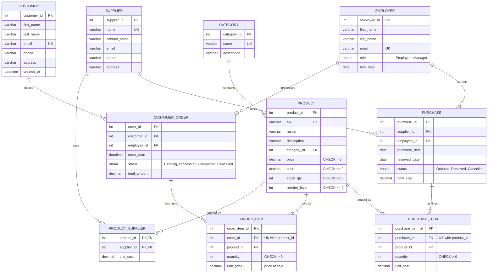

# GreenLeaf – Entity Relationship Diagram

Rendered image: `erd.svg` / `erd.png` (same folder). Source below is Mermaid; GitHub, VS Code (Markdown Preview Mermaid Support) and https://mermaid.live render it directly.

## Reading the cardinalities
- `||--o{` one-to-many (exactly one parent, zero or more children). Examples: one category has many products; one customer has many orders.
- `||--|{` one-to-many where the child side is **mandatory** (an order must have at least one line; a purchase must have at least one line – enforced by the API).
- The three many-to-many relationships (product↔supplier, order↔product, purchase↔product) appear as the associative entities `PRODUCT_SUPPLIER`, `ORDER_ITEM` and `PURCHASE_ITEM`.
